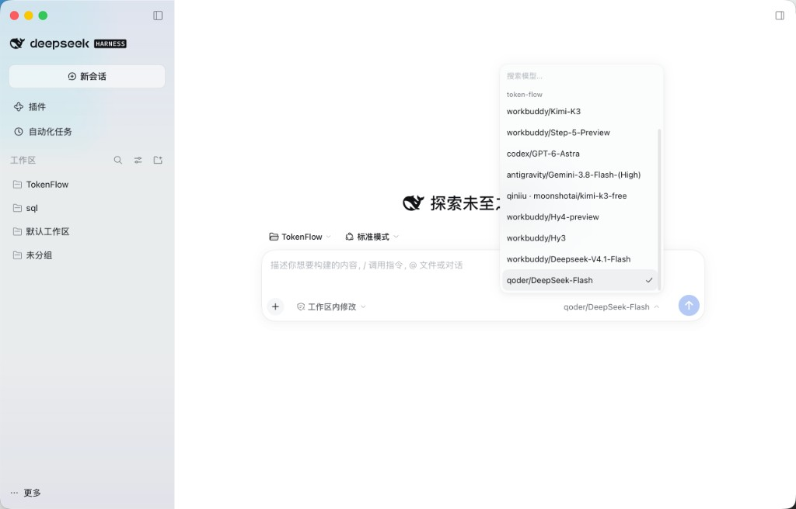
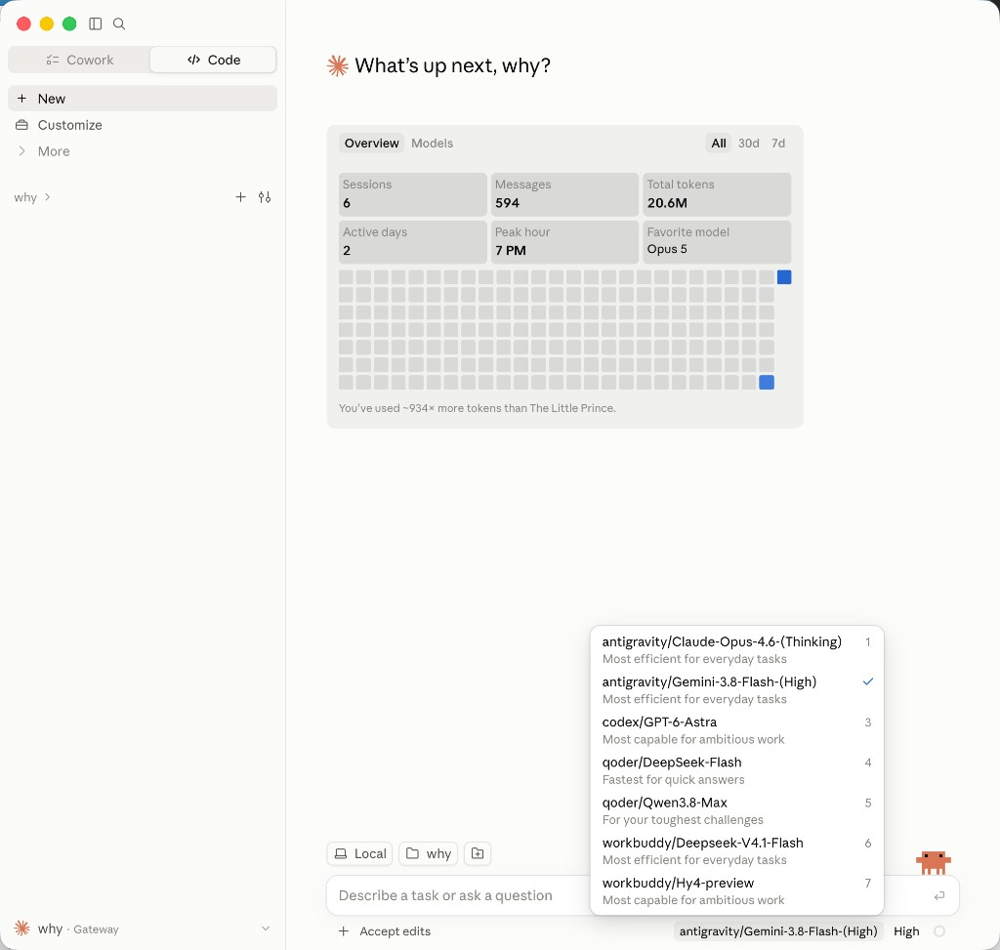

<div align="center">
  
  <h1>TokenFlow</h1>
  <p><strong>让你的模型，流向每个 Agent。</strong></p>
</div>

TokenFlow 是跑在本机的模型网关。Codex、Claude、WorkBuddy、Qoder、Antigravity 这些账号，以及你自己的 API，都放在这里管理。然后在 DeepSeek Harness、Claude Desktop、Codex、Claude Code 里直接选用。

人还在原来的软件里写。TokenFlow 只负责把这一次请求送到选中的来源，并记下用量。名字前面是来源，后面是模型。

<p align="center">
  
</p>

DeepSeek Harness 接入之后，新会话的模型菜单里就是这些来源。选 `qoder/DeepSeek-Flash`，这次调用用 Qoder 账号，对话仍在 DeepSeek Harness 里。

<p align="center">
  
</p>

Claude Desktop 的 Code 模式连上本机网关后也是同一套菜单。选 `antigravity/Gemini-3.8-Flash-(High)`，用的是 Antigravity 账号，编辑和任务仍在 Claude Desktop 里。

**[下载 macOS 版](https://github.com/haruinia/TokenFlow/releases/tag/v10.15.26)** · **[官网](https://token-flow.haruinia.chatgpt.site/)** · **[使用演示](doc/media/quickstart.mp4)** · **[使用指南](doc/guides/usage.md)**

<a id="三个常用场景"></a>

## 能做什么

**在熟悉的客户端里换模型。** 在账号授权里添加来源，或导入本机已经登录的账号。再到本地 Agent 里勾选要给这个客户端用的模型。重启后，在它自己的模型菜单里选择。调用消耗的是所选来源自己的额度或密钥。

**切换官方登录。** Codex、WorkBuddy、Qoder 可以在 TokenFlow 里换成另一个已授权账号，也可以恢复切换前的登录。这改的是客户端自己的登录，不改网页里的账号。官方登录和网关模型互不覆盖：导入模型不会退出官方账号，换官方账号也不会删掉已经导入的模型。

**看额度和用量。** 每个来源显示它自己的剩余额度。用量总览分开记：哪一个客户端在用，请求走的是哪个账号或 API，用了多少 Token。

**给其他应用一把 Key。** 在 API 代理里创建 Key，只开放需要的来源和模型。把本机地址、Key 和模型名填进那个应用即可。后来新加的来源不会自动进旧 Key。

来源包括 Codex、Claude、Antigravity、Kimi、xAI、Qoder、WorkBuddy、ZCode、Trae 和 Cursor。能自动写入配置的客户端有 Codex、Claude Code、Claude Desktop、WorkBuddy、Qoder、DeepSeek Harness 和 Pi。Qoder IDE 用来提供账号，Qoder 独立应用用来使用模型，这是两个入口。

文件、命令、审批和沙箱仍由你正在用的那个客户端负责。TokenFlow 把模型的回复交回去，不代替它执行。

## 安装

当前发布的是 Apple 芯片的 macOS 安装包：[TokenFlow 10.15.26](https://github.com/haruinia/TokenFlow/releases/tag/v10.15.26)。安装包没有 Apple 签名。第一次打开时，在 Finder 里对 TokenFlow 按住 Control，再点「打开」。

## 从源码运行

需要 Node.js 22.19 或更高版本、npm、Git，以及 Go 1.26 或更高版本。

```bash
git clone https://github.com/haruinia/TokenFlow.git
cd TokenFlow
npm ci
node scripts/fetch-upstream.mjs
npm run sidecar:build
npm run dev
```

| 命令 | 用途 |
| --- | --- |
| `npm run dev` | 构建并打开桌面应用。 |
| `npm run check` | 类型检查、测试和生产构建。 |
| `npm run package:mac:arm64` | 打 Apple 芯片安装包。 |

更细的操作步骤在 [使用指南](doc/guides/usage.md)。架构、待办和验收记录在 [文档目录](doc/README.md)。

## 数据与许可

账号、密钥、会话和配置都在本机的应用数据目录，不进入 Git。模型请求会发到你选中的那个来源。

[MIT 许可](LICENSE) · [第三方复用](THIRD_PARTY.md) · [问题反馈](https://github.com/haruinia/TokenFlow/issues)
